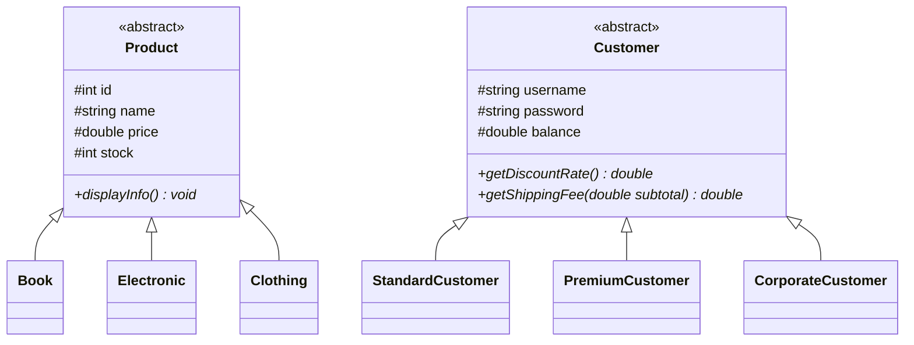

# 🛒 E-Commerce Console System (C++17 OOP)


A modular **Object-Oriented Programming (OOP)** e-commerce platform built in **C++17**. It features multi-tier customer authentication, a polymorphic product catalog, interactive shopping cart management, real-time stock tracking, and automated discount/shipping calculation.

---

## ✨ Key Features

- **Polymorphic Product Hierarchy:** Abstract base class `Product` extended by specialized domain classes (`Book`, `Electronic`, `Clothing`) with category-specific attributes (author/pages, warranty/brand, size/fabric).
- **Tiered Customer Pricing Engine:** Base `Customer` class with derived `StandardCustomer`, `PremiumCustomer`, and `CorporateCustomer` tiers offering dynamic discount rates and free-shipping thresholds.
- **Interactive Shopping Cart:** Supports adding/removing products, stock validation, quantity updates, and itemized receipt generation.
- **Persistent Account Loading:** Parses customer credentials, balances, and membership tiers from `data/customers.txt`.

---

## 🏗️ Class Architecture



---

## 🗂️ Project Structure

```text
Ecommerce-System/
├── data/
│   └── customers.txt        # Pre-configured customer accounts & tiers
├── include/
│   ├── Cart.h               # Shopping cart & checkout calculation logic
│   ├── Customer.h           # Customer hierarchy & discount rules
│   └── Product.h            # Product hierarchy & catalog items
├── src/
│   └── main.cpp             # Interactive CLI menu & authentication loop
├── CMakeLists.txt           # Cross-platform CMake build configuration
├── LICENSE                  # MIT License
└── README.md                # Project documentation
```

---

## 🚀 Getting Started

### Build with CMake
```bash
git clone https://github.com/Firatdondar/Ecommerce-System.git
cd Ecommerce-System
mkdir build && cd build
cmake ..
cmake --build .
```

### Run the Application
```bash
./ECommerceSystem
```

### Demo Login Credentials (`data/customers.txt`)
| Username | Password | Customer Tier |
| :--- | :--- | :--- |
| `aliveli` | `12345` | Standard / Premium / Corporate |

---

## 📄 License

Distributed under the **MIT License**. See [`LICENSE`](LICENSE) for details.
